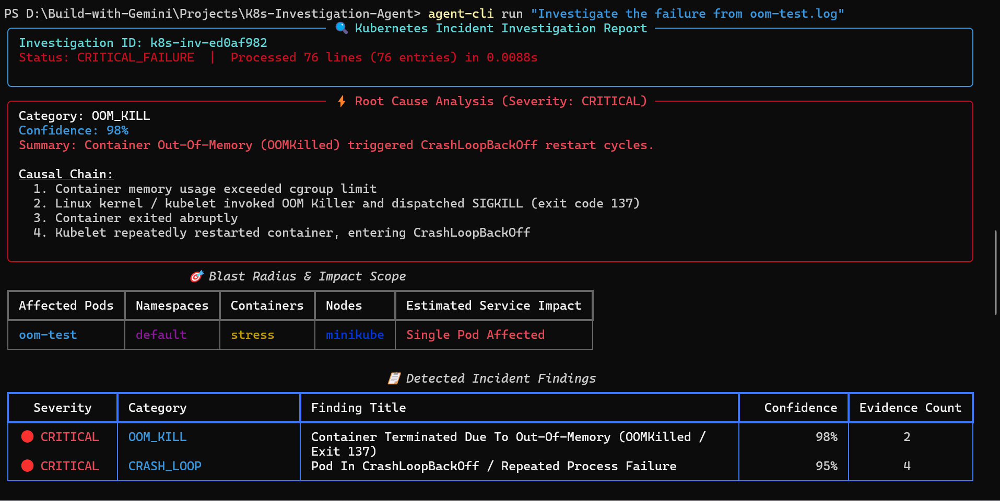

# Day 3: Making the Agent Self-Investigating with Tools (Tool/Function Calling)


## 🎯 Objectives
- Move the agent from **log-file input (v1)** to **live cluster investigation (v2)**.
- Understand **tool / function calling** and why an LLM needs it.
- Build three tools using natural-language prompts via Agent CLI + ADK:
  `get_pod_logs`, `get_pod_events`, `get_deployment_history`.
- Test against a real faulty pod on a Kubernetes cluster.

## 1. Where we started (Day 2 recap)
- Agent took a **log file** as input (`agent-cli run <logfile>`), investigated it and returned a report with evidence.
- Built via Agent CLI skills (**ADK code**, **workflow**) with the ADK framework.
- Sample report: container OOM-killed due to a JVM out-of-memory error, 99% confidence, with pod summary, root cause, evidence and remediation.
- **Gap:** a DevOps engineer still had to find the error and hand it to the agent. Not true *self-investigation*.

## 2. The core problem and concept

**Problem:** An LLM only generates text (predicts the next token). It **cannot connect to a Kubernetes cluster** or fetch data by itself.
**Solution:** **Tools (tool calling / function calling).**

| Concept | Explanation |
|---|---|
| **Tool** | A Python function that performs an action and returns the result in a form the LLM understands (typically a **JSON schema**). |
| **Flow** | LLM decides it needs info → requests it through the agent → the tool runs (e.g. calls the cluster) → returns JSON → LLM reasons over it. |
| **K8s access** | Tools use the **official Kubernetes Python client libraries** to talk to the cluster. |
| **ADK's role** | ADK creates tools according to its **declaration and schema** conventions. |
| **Agent CLI + skills** | You describe the tool in plain English; the coding agent uses the ADK code skill to write it. |

**Takeaway:** You don't need to hand-write the Python; you need to know how to design the architecture and how to use the agent skills.

## 3. Tools built

| Tool | Prompt used (summary) | Purpose |
|---|---|---|
| `get_pod_logs` | "Create a tool named get_pod_logs that fetches logs of a specific Kubernetes pod. Going ahead, the agent should use this tool instead of reading the log file as input." | Fetch container logs from the cluster |
| `get_pod_events` | "Create another tool called get_pod_events to fetch the events of a specific pod." | Fetch pod events (scheduling, pulls, failures) |
| `get_deployment_history` | "Create another tool called get_deployment_history to analyze any recent changes in the pod version." | Check recent version/deployment changes |

### How the coding agent worked (per tool)
1. Read the relevant skill (**Google agent CLI ADK code**) and reference `ADK python.md`.
2. Read the existing codebase (app folder, `agent.py`).
3. Produced an **implementation plan** (user approves it).
4. Implemented the tool in **`tools.py`** (the first one with *dual-mode execution*).
5. Updated **`agent.py`**: replaced the old `investigate_log_file` input with the tools in the tools section.
6. Updated/added **tests**.
7. Gave a summary of changes.

### Code changes at a glance
| File | Change |
|---|---|
| `tools.py` | New ADK tools using the Kubernetes Python client |
| `agent.py` | Tool list updated: `get_pod_logs`, `get_pod_events`, `get_deployment_history` replace log-file input |
| tests | Test cases added/updated per tool |

**Verification tip:** after each prompt, open `tools.py` and `agent.py` to confirm the tool exists and uses the Kubernetes client.

## 4. Testing

### Setup: faulty pod
```bash
kubectl create deployment nginx --image=<non-existent-image>
kubectl get pods        # expect ImagePullBackOff / ErrImagePull
```
(The video used a non-existent nginx image tag, e.g. `nginx:abc123`.)

### Run the agent (no log file now)
```bash
agent-cli run "identify nginx pod failure in the default namespace"
```
(Verify exact command names against your generated README, as in Day 2.)

### What the agent did
| Step | Tool called | Result |
|---|---|---|
| 1 | `get_pod_events` | Success; no significant events found |
| 2 | `get_deployment_history` | No previous deployments; this was the first deployment |
| 3 | `get_pod_logs` | **Exposed the exact error** |

### Final report
- Incident: **container image pull failure**, confidence **98%**
- Root cause: kubelet cannot pull the configured image from Docker Hub (ImagePullBackOff / ErrImagePull)
- Remediation: fix the image reference; configure image pull credentials; consider a private registry; use a valid image name and tag that exists in the public or private repo

**Result:** Agent became **self-investigating**. Input was only the pod name; it connected to the cluster, chose tools, and produced the report.

## 5. Extra insight: changing investigation order
The tool order can be tuned. Example: ask the coding agent (via a prompt) to start with `get_deployment_history`; Agent CLI + ADK will change the investigation pattern. In the demo, the default order was kept.

## 6. Compare v1 vs v2
| | v1 (Day 2) | v2 (Day 3) |
|---|---|---|
| Input | Log file | Pod name / natural-language request |
| Cluster access | None | Live, via Kubernetes Python client tools |
| Data gathering | Manual by engineer | Autonomous multi-step tool calls |
| Evidence source | Provided text | Logs + events + deployment history |
| Tests | Basic | Extended per tool |


## 🔐 Security notes (important for review)
- The agent now has **live cluster access**. Use a **least-privilege, read-only** kubeconfig/RBAC (read pods, events, logs, deployments only).
- Keep all tools **read-only**; no create/delete/patch yet.
- Never commit kubeconfig or credentials. Identity-based access comes later (Agent Identity, SPIFFE).

## 💡 Key takeaways
1. LLMs can't touch infrastructure; **tools are the bridge**.
2. A tool = a Python function returning LLM-readable (JSON) output.
3. Natural-language prompts + Agent CLI + ADK generate tools, but always **review the plan and the code**.
4. The agent decides tool order and combines evidence from several sources, which improves trustworthiness over a single log.
5. Tests were generated alongside the tools, which is good practice to keep.
6. This is a step toward production, but evaluation, runtime, memory, identity and observability are still ahead.

## ⏭ Next
Improve the **output efficiency / performance** of the agent (details to be added after Day 4).


******************************

## **Demo**

shakt@DESKTOP-RDBL7GP MINGW64 /d/Build-with-Gemini/Projects/K8s-Investigation-Agent (main)
$ kubectl create deployment nginx --image=nginxabc:123
deployment.apps/nginx created

shakt@DESKTOP-RDBL7GP MINGW64 /d/Build-with-Gemini/Projects/K8s-Investigation-Agent (main)
$ kubectl get deployments
NAME    READY   UP-TO-DATE   AVAILABLE   AGE
nginx   0/1     1            0           6s

shakt@DESKTOP-RDBL7GP MINGW64 /d/Build-with-Gemini/Projects/K8s-Investigation-Agent (main)
$ kubectl get pods
NAME                     READY   STATUS             RESTARTS         AGE
nginx-64567c87d6-hg6dr   0/1     ErrImagePull       0                12s
oom-test                 0/1     CrashLoopBackOff   43 (4m32s ago)   9h

## **Investigation Report for Deployment**



