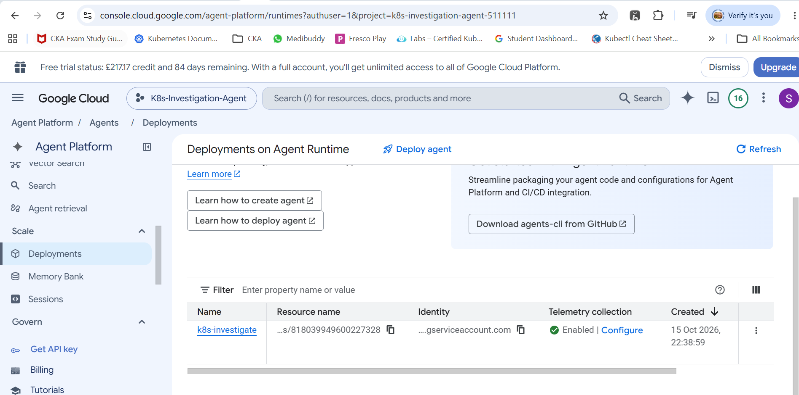

# Day 5: Deploying the Agent to Production (Agent Runtime, Cloud Run, GKE)

## 🎯 Objectives
- Understand the three production deployment targets supported by Agent CLI.
- Deploy the Kubernetes Investigation Agent to **all three**: Agent Runtime, Cloud Run, and GKE.
- Learn how deployment works internally (Dockerfile → container → target), how access is controlled, and how each target is tested.

## 1. Recap
Day 4 added evaluation and the `get_nodes_info` tool. The agent now has four tools (`get_pod_logs`, `get_pod_events`, `get_deployment_history`, `get_nodes_info`). Day 5 moves it from a local process to production.

## 2. Deployment targets (via the Agent CLI **deploy** skill)
All three are production-grade; pick by requirement.

| Target | Choose it when | What you get |
|---|---|---|
| **Agent Runtime** | You want managed infrastructure with minimal operations | Instant multi-turn memory, native user authentication, no infra handling; focus on agent code |
| **Cloud Run** | You want custom infrastructure with full networking control | Standard containers, custom VPC, serverless configuration |
| **GKE** | You want full Kubernetes control (or your org deploys on Kubernetes) | HPA, VPA, node auto-provisioning, Kubernetes networking |

### How the target is set
- The file **`agent-cli manifest`** at the project root (a YAML manifest) holds the **deployment target** (`none` until configured).
- Change it with the scaffold command, or just prompt the coding agent: *"Set agent runtime as the deployment target"* (the deploy skill updates the manifest).

### How deployment works internally
1. Agent CLI runs a **deploy** command with the project and region.
2. Uses the **Dockerfile** generated on Day 2 (scaffold) to build a **container image**.
3. Image is pushed and deployed to the chosen target.
4. Logs can be followed in **Cloud Logging / Log Explorer** (build layers, dependencies, etc.).

## 3. Deployment 1: Agent Runtime (simplest)
| Step | Detail |
|---|---|
| Prompt | "Set agent runtime as the deployment target", then ask the coding agent to deploy |
| Output | Deployment successful; returns **agent card URL**, **agent runtime ID**, **service account** |
| Verify | Agent Platform console → **Agents → Deployments** → "Kubernetes investigator" (initially 0 sessions / 0 average turns) |
| Test | Playground → new session → "Who are you?" returned the SRE/forensic specialist identity from the system prompt; "What investigations can you perform?" listed pod lifecycle, rollouts, events, node health, forensic logs |
| **Access control** | Tied to **IAM**: Service configuration → Access and permissions (who can use, read-only, administer), like any Google service |

## 4. Deployment 2: Cloud Run (custom networking)

### Plan (all done by prompting the coding agent, using `gcloud`)
1. **Custom VPC** (e.g. `k8s-agent-prod-vpc`) with a **private egress subnet** in us-east1, **Private Google Access** enabled.
2. **Cloud Router** + **Cloud NAT gateway** for the egress subnet.
3. **Configurable CIDR allow-listing**: new environment variable (e.g. `ALLOWED_CIDRS`) in the agent's Python code. Client IPs outside the range get **403 Forbidden**; set to `*`/all for public. *(Optional step; this one is a code change, so the ADK skill is used.)*
4. **Deploy** with **direct VPC egress** attached to the egress subnet.
5. **Grant access** (public or restricted).

### Results
| Check | Outcome |
|---|---|
| Resources | VPC, subnet (CIDR block/gateway), router, NAT created and verified in the console |
| Service | `k8s-investigator` in us-east1; egress policy set; **ingress not yet configured** |
| First access | Browser showed **403 Forbidden** (no unauthenticated access granted) |
| Prompt to open access | "Allow unauthenticated public access to the k8s-investigator Cloud Run service" (uses a `gcloud` IAM command) |
| After | Agent reachable in the browser with the **ADK web UI**; same identity/capability answers as before |

**Tip:** Ask for **Terraform** instead of `gcloud` if you prefer infrastructure-as-code. The agent defaults to `gcloud` otherwise.

### ADK Web UI features seen
Session management, per-session **invocations** with the tools used, **state**, **artifacts**, and the ability to **create an evaluation set** from the UI.

## 5. Deployment 3: GKE (full Kubernetes control)

### Plan (Terraform used here)
1. **Custom VPC network** for a **private GKE cluster**: VPC, GKE subnet, egress subnet, NAT router/gateway, firewall rules (Terraform files such as `network.tf`, `variables.tf`, outputs, APIs file under a `deployment/terraform` folder).
2. **Private GKE cluster** on the custom network with **Workload Identity** (first creation typically 10–15 minutes).
3. **Build and deploy** the agent workload: create a container **registry repository**, build the image from the same Dockerfile, tag and push, deploy the pod, expose it.
4. **Expose** via a **LoadBalancer service** (the video chose this; Ingress/Gateway API is the alternative).

### Why Workload Identity?
The agent pod runs **inside** the cluster but must securely call Gemini Enterprise Agent Platform **without static service account keys**.

### Results
| Check | Outcome |
|---|---|
| Cluster | `k8s-agent-cluster` in us-east1, node attached, networking verified in console; coding agent also ran a test pod to confirm health |
| Workload | `k8s-investigator` pod **Running**; image pulled from registry |
| Exposure | Service type LoadBalancer with an **external IP**; sample requests returned **HTTP 200** |
| Test | ADK dev UI loaded via the IP; "Who are you?" and "What can you do?" gave consistent answers |

**Access control on GKE:** the LoadBalancer is the simplest; **Ingress or Gateway API** lets you restrict by **CIDR/IP**, with allow/deny listing.

## 6. Comparison summary
| Aspect | Agent Runtime | Cloud Run | GKE |
|---|---|---|---|
| Ops effort | Lowest (managed) | Low-medium | Highest |
| Networking control | Managed | Custom VPC, direct egress | Full Kubernetes networking |
| Access control | IAM | Ingress setting / IAM / CIDR check in code | LoadBalancer / Ingress / Gateway API |
| IaC used in demo | Prompt only | `gcloud` | Terraform |
| Best for | Fast, governed deployment | Containers needing network control | Orgs standardised on Kubernetes |
| UI to test | Agent Platform playground | ADK web UI | ADK web UI |

## 7. Security and cost notes (my additions; not all from the video)
- **Do not leave public/unauthenticated access on** for an agent that can read cluster data. The video made Cloud Run public *for the demo*; for the repo and leadership review, document a restricted configuration (IAM, CIDR allow-list, Ingress/Gateway).
- The agent's cluster tools must stay **read-only** with least-privilege RBAC.
- Prefer **Workload Identity / service identity** over key files; never commit keys, `.tfstate`, `.tfvars` or kubeconfig. Add `*.tfstate*` and `.terraform/` to `.gitignore`.
- **Cost:** a GKE cluster, NAT gateway and load balancer incur ongoing charges against your free credits. **Tear down** what you don't need (`terraform destroy`, delete Cloud Run service/cluster) and record that in your notes.

## 8. My run 

## 💡 Key takeaways
1. Agent CLI + the **deploy skill** lets you deploy by natural language; the **Dockerfile** from scaffolding is reused for all container targets.
2. Pick the target by **control vs operational effort**: Agent Runtime → Cloud Run → GKE.
3. The deployment target lives in the **manifest**; the coding agent can change it.
4. **Networking and access control** are as important as deployment itself (IAM, CIDR allow-lists, private subnets, NAT, Workload Identity).
5. Infrastructure can be created via `gcloud` or **Terraform** simply by asking.
6. The same agent behaves consistently across all three targets.
7. Deployment is not governance: identity, policy and observability are still ahead.

